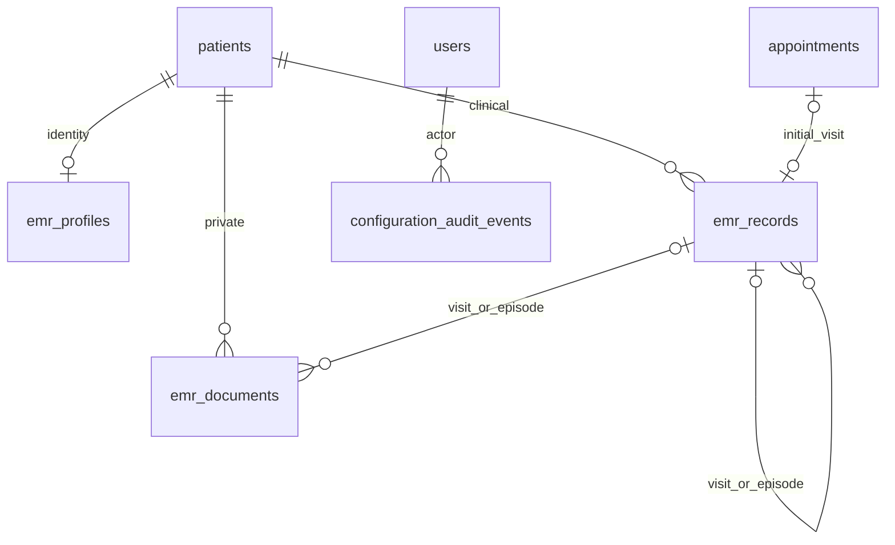

# پرونده پزشکی Ani Doctor

## تکمیل گردش پس از PR ۲۷

سه فاصله با نیازمندی اولیه تکمیل شد:

- **پرونده مشابه:** ارسال اول، شباهت نام/تماس/شناسه را در سرور بررسی می‌کند؛ وجود مشابه حتی با تیک ازپیش‌زده موجب توقف و نمایش فهرست اداری حداکثر ۱۰ مورد می‌شود. ثبت بعدی نیازمند تأیید انسانی و توکن رمزگذاری‌شده ۳۰دقیقه‌ای وابسته به کاربر، بیمار، داده ارسالی و نتیجه مشابهت است. تغییر داده یا دستکاری توکن نیازمند بررسی مجدد است؛ هیچ ادغام خودکاری انجام نمی‌شود. موارد بدون مشابه به تأیید عمومی بی‌معنا نیاز ندارند.
- **بخش‌های تخصصی:** پزشک برای هر بیمار قاعدگی، بارداری/پیگیری و ناباروری را صریحاً انتخاب می‌کند؛ انتخاب در پروفایل رمزگذاری‌شده با کنترل version نگهداری می‌شود. وجود سابقه قبلی همیشه بخش مربوط را قابل مشاهده نگه می‌دارد. این تنظیم فقط نمایش رابط است، نه تشخیص خودکار یا حذف سابقه. منشی نمی‌تواند آن را مشاهده/تغییر دهد و ذخیره اطلاعات اداری انتخاب پزشک را پاک نمی‌کند.
- **شروع ویزیت:** در سابقه نوبت بیمار، دکمه POST «شروع / ادامه ویزیت» فقط برای مدیر و نوبت confirmed/completed با حضور معتبر و بدون no-show نمایش داده می‌شود. کنترل سمت سرور، CSRF، تطبیق بیمار و قفل/یکتایی قبلی اعمال می‌شوند؛ تکرار درخواست همان ویزیت را باز می‌کند و وضعیت نوبت/پرداخت را تغییر نمی‌دهد. پیش‌نویس جدید خالی است و بدون شرح قابل امضا نیست.

این تکمیل migration و نقش جدید ندارد. توکن تأیید مشابهت به نشست خطای همان فرم منتقل می‌شود؛ فهرست مشابه فقط داده اداری دارد. بکاپ معمول کد/DB/storage و حفظ APP_KEY همچنان لازم است. rollback این تکمیل بازگشت release قبلی با حفظ DB، فایل‌ها و کلیدهاست؛ preferences جدید می‌توانند در identity باقی بمانند و نیاز به حذف داده نیست.

آزمون‌ها: سناریوهای توکن دستکاری‌شده/تغییر ورودی، کنترل سمت سرور حتی با تیک اولیه، نمایش هشدار مرورگر، تنظیم تخصصی/سابقه قبلی/تعارض نسخه/منشی، حفظ تنظیم هنگام ویرایش اداری، و شروع نوبت بدون حضور/برای بیمار دیگر/منشی/تکرار/CSRF اضافه یا اصلاح شدند. تست مرورگر EMR در عرض‌های مختلف، هشدار و تأیید مشابهت و فعال‌سازی بخش تخصصی را نیز اجرا می‌کند.

تصمیم‌های پزشکی خارج از این تغییر: تعریف G/P و طبقه‌بندی پیامدها و نحوه شمارش ساختاریافته، سیاست ثبت/رضایت اطلاعات شریک زندگی، و هرگونه قاعده محدودکننده بارداری فعال. هیچ‌کدام به‌صورت حدسی اعمال نشدند. اسکن بدافزار، سیاست حقوقی و ظرفیت سرور واقعی نیز مستقل‌اند؛ بررسی و نصب روی هاست همچنان معلق است. نصب آزمایشی موجود با این شاخه به‌روزرسانی نشده و production تغییر نکرده است.

نتایج نهایی این تکمیل: کل SQLite برابر ۳۸۶ تست / ۳۳۴۰ assertion موفق؛ EMR روی MySQL QA جدا برابر ۲۹ تست / ۳۰۴ assertion موفق؛ مرورگر Chromium با هشدار مشابهت/تأیید و فعال‌سازی بخش تخصصی و رگرسیون ویزیت/مدارک در عرض‌های ۳۲۰/۷۶۸/۱۴۴۰ موفق؛ Pint، diff check و composer audit تولید موفق. تست مرورگر پیش از آخرین اصلاح حفظ صرفاً کلید enabled_sections اجرا شد؛ پس از آن اصلاح، مجموعه کامل SQLite و MySQL دوباره موفق شدند. این نتایج محلی‌اند و وضعیت CI PR جدید باید مستقل خوانده شود.

## ممیزی فاز صفر — ۱۴۰۵/۰۸/۰۸

مبنای کار `1cc8844e4b38113491b236029002aff0e5083b4d`، شاخه `feature/patient-medical-records`؛ working tree اولیه پاک بود. دستور صریح مالک، توقف پس از ممیزی سند پیوست را لغو کرده است. هیچ اتصال یا داده تولیدی استفاده نمی‌شود.

### شواهد و روابط موجود

- `composer.json`: Laravel 13 / PHP 8.4؛ محیط سیستم PHP 8.3 بود؛ runtime محلی مستقل PHP 8.4 برای تست آماده شد.
- `Patients/Infrastructure/Patient.php` و migration هویت: بیمار مستقل، نام، تماس مشترک مجاز، file_number nullable unique. `patient_user_links` صرفاً پیوند مالکیت است؛ موبایل هویت یکتا نیست.
- `Booking/Infrastructure/Appointment.php` و migration رزرو: patient_id مستقل از booker و notification_mobile؛ چرخه حضور، ظرفیت و پول در سرویس‌های موجود حفظ می‌شود. ویزیت EMR وضعیت نوبت را تغییر نمی‌دهد.
- `RoleSeeder.php` / `User.php`: نقش‌های داخلی admin و secretary، بیمار نقش عمومی موجود؛ patients.manage و desk.view برای هر دو؛ panel.admin فقط مدیر. نقش جدید یا RBAC موازی لازم نیست.
- `DynamicForms/Application/PrivateFormService.php`: پاسخ‌های خصوصی نسخه‌دار، انتقال خودکار پاسخ به پرونده انجام نمی‌شود.
- `SettingsAudit/Application/AuditService.php`: رویداد پیکربندی موجود؛ رویداد EMR فقط شناسه/اقدام/نتیجه دارد، بدون متن پزشکی.
- `Operations/Application/BackupService.php`: بکاپ هماهنگ MySQL + storage/app/private با توقف نویسنده‌ها و رمزگذاری؛ restore فقط مقصد خالی جدا. مدارک EMR زیر همین پوشه نگهداری می‌شوند.
- `layouts/app.blade.php`، `panel-navigation.blade.php`، `desk/patient.blade.php`، `docs/PANEL-UI.md`: بازاستفاده از پنل Tabler/Bootstrap RTL، Vazirmatn، ux-card، field-grid، data-persian-date و JalaliDate؛ بدون SPA یا وابستگی UI جدید.
- `SecurityHeaders.php`: no-store/private، no-referrer، CSP؛ فرم POST برای جستجو؛ throttle و CSRF موجود.
- `phpunit.xml` و workflow release-package: SQLite واحد/feature، MySQL integration و drill بازیابی موجود؛ اجرای محلی به معنی تأیید MySQL/مرورگر/تولید نیست.

### دسترسی و UX

| عملیات | مدیر/پزشک | منشی | بیمار/مهمان |
|---|---|---|---|
| اطلاعات اداری، تشکیل پرونده، جستجو | مجاز | مجاز با مجوز موجود | ممنوع در EMR |
| ارسال مدرک برای بررسی | مجاز | مجاز بدون نام اصلی/محتوا | ممنوع |
| سوابق، حساسیت، ویزیت، نسخه، تخصصی، یادداشت | مجاز | ممنوع | ممنوع |
| امضا، الحاقیه، دانلود، چاپ، audit | مجاز | ممنوع | ممنوع |

مدیر از بیمار موجود به پرونده و بخش‌های کوچک بالینی می‌رود؛ منشی همان پذیرش و اطلاعات اداری را می‌بیند. تمام مسیرها در سرور کنترل می‌شوند؛ رابط منشی هیچ query بالینی اجرا نمی‌کند. حداقل دسترسی از نقش و permission فعلی با هم احراز می‌شود.

### طرح داده و اجرا

Patient ← EMR profile (یک‌به‌یک، اطلاعات تکمیلی اداری رمزگذاری‌شده و blind index شناسه)؛ Patient ← clinical records (نوع ساخت‌یافته، payload رمزگذاری‌شده، نسخه، زمان وقوع و ثبت، نویسنده، parent)؛ appointment ← visit (قید یکتا، FK، قفل بیمار)؛ pregnancy episode ← followup/visit/document؛ visit ← prescription/document/note؛ Patient ← documents (blob رمزگذاری‌شده، شناسه تصادفی، بازبینی و آرشیو)؛ تمام رویدادها ← audit موجود.

Migration افزایشی است؛ هیچ backfill خودکار هویت/رزرو یا ادغام بیمار انجام نمی‌شود. ثبت پرونده EMR برای بیمار موجود صریح است؛ شماره انسانی در صورت خالی‌بودن با شناسه داخلی یکتا ساخته می‌شود. clinical records نسخه نهایی را overwrite نمی‌کند؛ اصلاح، رکورد فرزند با علت و زمان است. قفل بیمار + expected_version + unique appointment جلوی ثبت تکراری و تعارض را می‌گیرد.

ترتیب اجرا: هویت/مجوز/ممیزی، چرخه ویزیت و نسخه، مدارک خصوصی، تخصصی، تست منفی/رگرسیون و مستندات. هیچ قابلیت نمایشی یا تشخیص/تجویز ماشینی ساخته نمی‌شود.

### تصمیم‌های باز و مرزهای انتشار

حوزه حقوقی، محل استقرار، سیاست نگهداری/رضایت و RPO/RTO تا تأیید مالک نامشخص است. تعریف G/P و طبقه‌بندی پیامدها تصمیم پزشک است؛ شمارش خودکار یا تعیین قطعی سن بارداری نداریم. محدودیت یک بارداری فعال اعمال نمی‌شود. اسکن بدافزار و تأیید مستقل امنیت باید پیش از انتشار ارزیابی شوند؛ PDF غیرقابل اعتماد فقط attachment و با بازبینی پزشک است. داده شریک زندگی اختیاری و حداقلی است؛ رضایت مستقل باید ثبت شود. دسترسی عمومی بیمار، break-glass و merge خودکار پرونده وجود ندارد.

## معیار پذیرش و خطرات

جداسازی نقش در تمام endpointها، حفظ هویت بیمار/رزروکننده، unknown در برابر negative، تاریخچه امضا/اصلاح، قید یک ویزیت برای نوبت، کنترل ارتباط‌های بین بیمارها، فایل خصوصی بدون نام اصلی و محتوای رمزگذاری‌شده، audit بدون متن حساس، عدم تغییر گردش مالی/نوبت و تست واقعی ضروری‌اند. این سند با شواهد نهایی، محدودیت‌ها، تست دستی و rollback تکمیل می‌شود.

## معماری و مدل نهایی

`emr_records.kind` قرارداد ساخت‌یافته ClinicalSchema است، نه JSON آزاد. فیلدهای مجاز هر نوع در FormRequest کنترل می‌شوند؛ کل payload رمزگذاری می‌شود و قابل query پزشکی نیست. وضعیت `draft/final` مستقل از وضعیت دوره بارداری `unknown/active/ended` است. نام و تماس بیمار برای سازگاری با رزرو قبلی plaintext می‌مانند؛ شناسه تکمیلی، آدرس و توضیح اداری رمزگذاری هستند. شماره ملی/گذرنامه با HMAC جستجوی دقیق دارد؛ جستجوی جزئی نام از رفتار فعلی SQL LIKE استفاده می‌کند و در مقیاس بسیار بزرگ باید query plan بررسی شود. موبایل و شناسه خانوادگی موجب ادغام خودکار یا قید unique نمی‌شود.

ثبت اول پزشکی/مدرک یا ذخیره اطلاعات اداری، شماره پرونده خالی را با `EMR-<id>` و رفع تعارض احتمالی پر می‌کند؛ شماره قبلی حفظ می‌شود. هویت بیمار یا اطلاعات حساب رزروکننده backfill نمی‌شود. ویزیت متصل به نوبت فقط برای همان patient_id، نوبت confirmed/completed و حضور ثبت‌شده است؛ مراجعه بدون نوبت مستقل مجاز است. سرویس هیچ وضعیت حضور، ظرفیت، پیامک یا پرداختی را عوض نمی‌کند.

در امضا، متن نهایی و signed_at ثبت می‌شود. تغییر نهایی فقط با رکورد فرزند، علت و نویسنده انجام می‌شود؛ یک والد فقط یک اصلاح بعدی دارد و اصلاح بعدی باید از آخرین نسخه نهایی شروع شود. پیش‌نویس در DB واقعی است، expected_version تحت قفل بیمار کنترل می‌شود و درخواست تکراری request_key همان نتیجه را می‌دهد. شماره نوبت در DB unique و همه FKها restrict هستند. ذخیره مجدد پیش‌نویس متن نهایی را تغییر نمی‌دهد؛ draftها audit نسخه دارند، snapshot هر کلید فشرده‌شده مرورگر ندارند.

عناوین و متن کامل پزشکی در audit نیست. رویداد شامل actor، action، patient/record ID، outcome، correlation ID و زمان سرور است. read/download/sign/amend/export و رد دسترسی ثبت می‌شوند. رویدادهای جستجوی ناموفق متن جستجو را ذخیره نمی‌کنند. export فقط مدیر و بدون یادداشت خصوصی، به صورت HTML محرمانه مناسب چاپ مرورگر است؛ ادعای اتصال قانونی نسخه‌نویسی یا PDF رسمی نداریم.

### فایل‌ها و بازیابی کلید

فقط PDF/JPEG/PNG، سقف پیش‌فرض ۱۰MB در `config/medical-records.php`؛ MIME، پسوند و امضا با هم کنترل می‌شوند. تصاویر حداکثر ۲۰ میلیون پیکسل‌اند و قابلیت رمزگشایی آن‌ها کنترل می‌شود؛ اصل فایل بدون بازفشرده‌سازی یا تغییر شواهد بالینی حفظ می‌شود؛ نام اصلی اصلاً نگهداری نمی‌شود. فایل رمزگذاری‌شده خارج public و داخل مسیر بکاپ فعلی است. کنترل دانلود پیش از بازکردن فایل، no-store/private و attachment اجباری‌اند. فایل‌های قدیمی با آپلود جدید بازنویسی نمی‌شوند؛ پزشک آن‌ها را بازبینی یا آرشیو می‌کند. اسکن ضدبدافزار و پیش‌نمایش امن داخلی افزوده نشده؛ pending به معنی «تأییدنشده» است. PDF باید در viewer ایزوله و بدون اجرای محتوا باز شود. پردازش رمزگذاری/رمزگشایی در حافظه و خروجی chunk است؛ سقف فایل برای محدودیت حافظه ضروری است.

از APP_KEY نسخه امن خارج Git و خارج backup archive نگه دارید؛ کلید مستقل backup هم جدا escrow شود. با از دست رفتن APP_KEY، متن‌ها و مدارک بازیابی نمی‌شوند. چرخش APP_KEY نیازمند اجرای خصوصی برنامه بازرمزگذاری و بازسازی identity_hash با حفظ کلید قبلی است؛ تعویض ساده env مجاز نیست. این PR ابزار چرخش خودکار ندارد.

## راه‌اندازی و انتشار صرفاً آزمایشی

1. نسخه این شاخه، PHP 8.4 و وابستگی‌های composer.lock را در محیط ایزوله با DB و فایل مصنوعی نصب کنید. providerهای SMS/پرداخت خاموش باشند.
2. قبل از migration، پنجره توقف نوشتن و backup هماهنگ فعلی را با APP_KEY و کلید backup جدا اجرا و خروجی را بررسی کنید؛ راهنمای `docs/P8.md` معتبر است.
3. فقط migration افزایشی `2026_10_30_180000_create_medical_records.php` اجرا می‌شود. migration داده هویتی موجود را تغییر نمی‌دهد و role/permission تازه نمی‌سازد؛ RoleSeeder نیاز به تغییر ندارد.
4. برای مقایسه تعداد بیماران و نوبت‌ها، قبل/بعد شمارش بدون نمایش نام و اطلاعات پزشکی بگیرید. اتصال مستقیم Patient→User از روی موبایل ممنوع است.
5. DocumentRoot=public، پوشه private بدون symlink عمومی، HTTPS، نشست رمزگذاری‌شده، APP_DEBUG=false، ACL فایل/کلید و عدم ثبت body/query در access log بررسی شوند.
6. قبل از استقرار واقعی، تمرین restore در مقصد جدا، آزمون نقش‌ها، فضای دیسک/حافظه و مرورگرها انجام شود. محل داده، رضایت/retention و دسترسی کارکنان با مالک و مسئول حقوقی تعیین شود. این مراحل مجوز Deploy نیستند؛ merge و deploy نیازمند تأیید مالک‌اند.

## Rollback بدون حذف تاریخچه

اگر هنوز هیچ داده EMR ثبت نشده، migration down فقط سه جدول جدید خالی را حذف می‌کند. اگر هر داده‌ای وجود داشته باشد، down عمداً با `EMR_DATA_PRESENT_USE_DOCUMENTED_CODE_ROLLBACK` متوقف می‌شود؛ هیچ جدول یا فایل بالینی حذف نمی‌شود. `migrate:fresh`، `db:wipe` و حذف فایل‌ها در محیط دارای داده ممنوع‌اند.

در شکست انتشار، نوشتن را متوقف کنید، کد/وابستگی نسخه پیشین را بازگردانید، سه جدول جدید و فایل/کلیدها را حفظ کنید و شمارش بیماران/نوبت/مالی را تطبیق دهید. کد قبلی جدول‌های جدید را نادیده می‌گیرد؛ شماره پرونده تخصیص‌یافته حفظ شود. اگر بازیابی لازم است، با ابزار Operations فقط DB خالی جدا و پوشه فایل تازه را restore کنید؛ هیچ promotion یا overwrite فعال خودکار انجام نمی‌شود. پیش از cutover، وضعیت نشست/OTP/صف و تأیید مالک طبق P8 بررسی شود.

## آزمون دستی مالک

- با حساب مدیر واقعی آزمایشی، بیمار جدید بدون تاریخ تولد/کد ملی بسازید؛ نام مشابه، تماس مشترک و تأیید انسانی تکرار را بررسی کنید. اصلاح اطلاعات بیمار نباید رزروکننده یا مالک نوبت را عوض کند.
- با منشی همان اطلاعات اداری را ویرایش و یک سند مصنوعی ارسال کنید. منشی نباید محتوای پزشکی، نام اصلی فایل، لینک دانلود، یادداشت، شمارش بالینی یا خروجی چاپ را ببیند؛ URL مستقیم آن‌ها هم باید ممنوع باشد.
- حضور بیمار را در میز فعلی ثبت، سپس مدیر ویزیت را از همان نوبت شروع کند؛ دابل‌کلیک فقط یک ویزیت بسازد. draft را در دو تب ویرایش و تعارض نسخه را مشاهده کنید؛ نهایی‌سازی، اصلاح با علت و نمایش اصل/الحاقیه را بررسی کنید.
- حساسیت unknown، negative و positive، نسخه مرتبط با ویزیت، نتیجه با واحد و مرجع، قاعدگی بدون LMP و دو دوره بارداری با dating مستند را امتحان کنید. سن بارداری فقط «برآورد محاسباتی» در تاریخ مشخص است؛ تشخیص/درمان ماشینی ندارد.
- مدرک نامعتبر/بزرگ و نام افشاگر مصنوعی را تست کنید؛ فایل فقط پزشک دانلود شود. آرشیو نباید bytes قبلی را حذف کند. خروجی محرمانه چاپ نباید یادداشت خصوصی را شامل شود.
- فرم‌ها را در موبایل ۳۲۰px، دسکتاپ، zoom ۲۰۰٪ و با کیبورد بررسی کنید. فرم نامعتبر باید داده‌های همان فرم را نگه دارد؛ تغییر ذخیره‌نشده هشدار خروج بدهد. بستن/بازکردن فایل دانلودشده فقط در محیط امن انجام شود.

## مرزهای باز برای پذیرش

این پیاده‌سازی EMR داخلی است؛ اتصال رسمی نسخه، تفسیر خودکار آزمایش، تصمیم درمانی، محاسبه خودکار G/P، داده شریک زندگی بدون رضایت، ادغام خودکار بیماران، دسترسی بیمار و break-glass وجود ندارد. سیاست حقوقی، رضایت، retention، scanner، ظرفیت واقعی و RPO/RTO هنوز تصمیم استقرارند. تست مرورگر خودکار جای پذیرش دستی پزشک/منشی، ابزار دسترس‌پذیری و ارزیابی مستقل نفوذ را نمی‌گیرد. وضعیت واقعی تست‌ها در بخش شواهد نهایی درج می‌شود.

## شواهد اجرای واقعی — ۱۴۰۵/۰۸/۰۸

PHP محلی مستقل 8.4.27، Laravel قفل‌شده 13.38.0، PHPUnit 12.5.40 و MySQL ایزوله 8.4.3 روی loopback استفاده شد؛ هیچ env یا داده تولیدی مصرف نشد. تنظیم `zend.exception_ignore_args=On` مطابق `deployment/php-production.ini` برای جلوگیری از نمایش آرگومان محرمانه در exceptionها اعمال شد. PHP پیش‌فرض سیستم عوض نشده است. دریافت mPDF کند بود؛ بسته نصب‌شده محلی با همان نسخه 8.3.1 و همان source revision قفل‌شده `2a454ec334109911fdb323a284c19dbf3f049810` برای وابستگی توسعه استفاده شد؛ composer.json و composer.lock تغییر نکرده‌اند و نصب تمیز CI مستقل باید بررسی شود.

| بررسی اجراشده | نتیجه |
|---|---|
| مجموعه کامل Unit/Feature روی SQLite | موفق روی کد نهایی: ۳۸۰ تست، ۳۲۶۸ assertion |
| EMR + WebSecurity + P8Hardening روی MySQL | موفق روی کد نهایی: ۳۳ تست، ۳۰۱ assertion؛ شامل هدر دانلود، مرور بخش‌ها و رد دسترسی بیمار/منشی |
| کل Integration روی MySQL | موفق: ۵۳ تست، ۳۹۱ assertion، شامل رزرو/مالی/حضور و رقابت EMR |
| رقابت EMR + بکاپ/بازیابی هدفمند | موفق: ۸ تست، ۵۸ assertion؛ بازیابی واقعی payload رمزگذاری‌شده، مدرک اصلی و ارتباط ویزیت در مقصد جدا |
| امنیت نهایی EMR + WebSecurity + P8Hardening | موفق: ۳۳ تست، ۲۹۹ assertion، سپس دو assertion تکمیلی CSRF/بیمار در مجموعه کامل و MySQL بالا تأیید شد؛ CSRF، role/permission، IDOR، cache، XSS و CSP دانلود |
| Chromium واقعی | موفق: عرض‌های ۳۲۰/۷۶۸/۱۴۴۰، draft واقعی، sign، amendment و حفظ اصل، منشی ممنوع، XSS escape، متن ۲۰۰٪ و focus کیبورد |
| Pint و syntax | موفق؛ نحو تمام ۳۴ فایل PHP تغییرکرده بررسی شد |
| Composer audit --locked --no-dev | موفق؛ advisory شناخته‌شده‌ای گزارش نشد؛ گواهی امنیت کامل نیست |
| مجموعه کامل Unit/Feature روی MySQL | موفق: ۳۷۸ تست، ۳۲۴۵ assertion، زمان ۲۸:۰۷؛ دو تستی که پس از شروع این اجرا اضافه شدند، در مجموعه نهایی ۳۳تستی MySQL نیز موفق‌اند |

در اجرای اولیه، یک خطای directive قالب، مقدار expected_version=0 فرم ایجاد، و فرض قدیمی ترتیب migration در ۸ تست پیدا و اصلاح شد؛ تست‌های مربوط دوباره اجرا شدند. حفظ تاریخ شمسی در خطای فرم با تست ارسال مجدد پوشش دارد. فایل اصلی پزشکی بازفشرده‌سازی نمی‌شود؛ checksum اصل و دانلود در تست برابر است. هیچ شکست شناخته‌شده مرتبط با ماژول در اجراهای موفق بالا باقی نماند.

### اندازه‌گیری عملکرد مصنوعی

`tests/Support/emr-performance.php` فقط روی DB خالی با نام دقیق `ani_doctor_test_emr_perf` و APP_ENV=testing اجرا می‌شود. ۱۰هزار بیمار ساختگی، ۲۰ بار جستجوی صفحه‌بندی‌شده: p95 شماره پرونده ۱٫۵۵ms (plan=const، unique index، یک ردیف)، p95 نام جزئی ۱۴٫۴۴ms (پیمایش ۱۰هزار ردیف از PRIMARY، blind index هویت در subquery). این بار کوچک روی یک رایانه است، نه ظرفیت تضمین‌شده تولید. جستجوی نام هنوز خطی است؛ اگر حجم واقعی بسیار بیشتر شود، طرح ایندکس/جستجوی حریم‌خصوصی با اندازه‌گیری تازه لازم است. اندازه‌گیری فایل، تصاویر حجیم و عملیات backup با حجم واقعی اجرا نشده‌اند.

### بررسی امنیتی کد و حدود شواهد

بازبینی دستی مسیرها و سرویس‌ها: کنترل نقش پیش از binding، کنترل patient_id/kind تمام پیوندها، فیلدهای مجاز و protected serialization، FK/unique/locking، خروجی escaped، عدم ذخیره filename و محتوای پزشکی در audit، ذخیره خصوصی رمزگذاری‌شده، attachment + nosniff + CSP، rollback محافظه‌کار و عدم تغییر booking/payment بررسی شدند. تست‌های منفی شواهد اجرایی‌اند؛ ZAP/تست نفوذ مستقل، دستگاه‌های واقعی، Safari/Firefox، صفحه‌خوان، بانک/SMS واقعی و استقرار production در این کار اجرا نشده‌اند. CI بسته نصب، staging HTTPS و بررسی‌های موجود خود را جدا اجرا می‌کند؛ وضعیت آن باید از PR خوانده شود.

برای بازتولید: `php -d zend.exception_ignore_args=On vendor/bin/phpunit`؛ برای MySQL، متغیرهای DB را فقط به دیتابیس مصنوعی خالی با prefix `ani_doctor_test` متصل و `vendor/bin/phpunit -c phpunit.mysql.xml` اجرا کنید. مرورگر از fixture guard فعلی با `emr-browser-seed.php` و `tests/Browser/medical-records.mjs` استفاده می‌کند؛ router آزمایشی هرگز در استقرار نباشد. Screenshotها فقط داده مصنوعی دارند و زیر مسیر ignored `tests/Browser/results` هستند.

بازیابی روی آخرین کد حفظ اصل مدرک نیز جدا تکرار شد: یک تست واقعی MySQL / ۱۷ assertion موفق؛ checksum مدرک بازیابی‌شده و ارتباط ویزیت حفظ شد. فیلتر بخش‌های بالینی فقط با POST خصوصی پزشک و صفحه‌بندی سرور کار می‌کند؛ منشی و بیمار اجازه استفاده ندارند. خلاصه حداکثر ۲۰ ثبت اخیر هر بخش است و در UI به صراحت کامل‌نبودن آن و مسیر مرور کامل اعلام می‌شود.

یادداشت محیط MySQL: در اواخر اجرای طولانی Unit/Feature، فقط روی سرور مصنوعی مستقل پورت 19337، innodb_flush_log_at_trx_commit=2 و sync_binlog=0 تنظیم شد تا انتظار نوشتن دیسک کاهش یابد؛ هیچ تنظیم تولیدی یا MySQL موجود کاربر تغییر نکرد. این آزمون‌ها صحت رفتار/قفل/مجوز و بازیابی برنامه را می‌سنجند و آزمون دوام در قطع برق نیستند. تمرین نهایی restore و مجموعه Integration پیش از این تغییر با تنظیم اولیه سرور موفق شده بودند. CI نصب تمیز، MySQL و staging مستقل خود را دارد و در زمان تحویل هنوز در حال اجراست؛ موفقیت نهایی CI یا بسته استقرار در این گزارش ادعا نشده است.

## آزمون گردش واقعی پس از نصب لوکال و اصلاح فرم‌ها

پس از نصب artifact موفق PR27 در پوشه و MySQL مستقل، با دو حساب آزمایشی موجود و ورود عادی OTP لوکال (بدون fixture ورود) گردش واقعی بررسی شد. نتیجه نهایی: ۵۱ بررسی مرورگر موفق، بدون مورد باز؛ تشکیل پرونده، ویرایش اداری منشی، ذخیره/بازخوانی/تعارض نسخه ویزیت، امضا، منع بازنویسی، الحاقیه با علت و حفظ اصل، PNG/PDF/JPEG، دانلود عین bytes، بازبینی/آرشیو، فایل نامعتبر و بزرگ، audit، چاپ، IDOR و منع دسترسی منشی/مهمان پوشش داشتند. در UI لوکال این بار ویزیت بدون نوبت استفاده شد؛ ارتباط حضور/نوبت در تست MySQL ماژول نیز پوشش دارد.

چهار ایراد بازتولید و اصلاح شدند:

1. تأیید بررسی پرونده‌های مشابه در backend اجباری بود، ولی checkbox مرورگر required نبود و خطای آن نام انگلیسی فیلد داشت؛ اکنون الزام و پیام فارسی روشن‌اند.
2. پس از بایگانی سند، select دوباره گزینه بازبینی‌شده را نشان می‌داد؛ اکنون وضعیت persisted و ورودی خطادار همان فرم درست نمایش داده می‌شود.
3. پس از رد فایل نامعتبر، عنوان، تاریخ، منبع، توضیح و پیوندهای واردشده از فرم پاک می‌شدند؛ اکنون با UiInput و context مستقل هر فرم حفظ می‌شوند و به فرم بازبینی سند دیگر سرایت نمی‌کنند. دسته/منبع/تاریخ ذخیره‌شده سند نیز فقط در نمای پزشک نمایش داده می‌شود.
4. دانلود attachment در تاریخچه نشست، صفحه قبلی را عوض می‌کرد؛ خطای فرم بعدی به‌جای صفحه پرونده به فایل دانلودی redirect می‌شد. UiSessionHistory اکنون endpoint دانلود EMR را همانند assetها از تاریخچه ناوبری کنار می‌گذارد؛ no-referrer و سایر هدرهای امنیتی تضعیف نشده‌اند.

تست‌های رگرسیون ابتدا خطاها را نشان دادند و پس از اصلاح موفق شدند. نتایج نهایی: کل SQLite برابر ۳۸۴ تست / ۳۳۰۰ assertion؛ ماژول روی MySQL دیتابیس QA جدا برابر ۲۷ تست / ۲۶۴ assertion؛ تست مرورگر قابل تکرار CI با عرض‌های ۳۲۰/۷۶۸/۱۴۴۰، متن ۲۰۰٪، امضا/الحاقیه و گردش مدارک موفق؛ Pint و diff check موفق. هیچ تست PHPUnit روی دیتابیس نصب فعال اجرا نشد. تصویر خرابِ اولین fixture نیز به‌درستی رد شد و برای آزمون مثبت با تصویر معتبر ساخته‌شده جایگزین شد.

اصلاح نصب فقط چهار فایل `MedicalProfileRequest.php`، `UiSessionHistory.php` و Bladeهای `emr/profile` و `emr/show` را با بکاپ قبلی عوض کرد؛ migration، role، env، APP_KEY و داده‌های موجود تغییر نکردند. بازگشت این اصلاحیه، بازگرداندن همین چهار فایل از بکاپ و پاک‌کردن cache قالب است؛ هیچ حذف/rollback دیتابیس لازم نیست. بسته CI قبلی پایه نصب است و این نصب اکنون اصلاحیه کد PR را نیز دارد؛ verifier بسته خام قدیمی پس از patch معیار تطبیق فایل‌های جدید نیست. CI commit جدید باید مستقل بررسی شود؛ merge و production انجام نشده‌اند.
